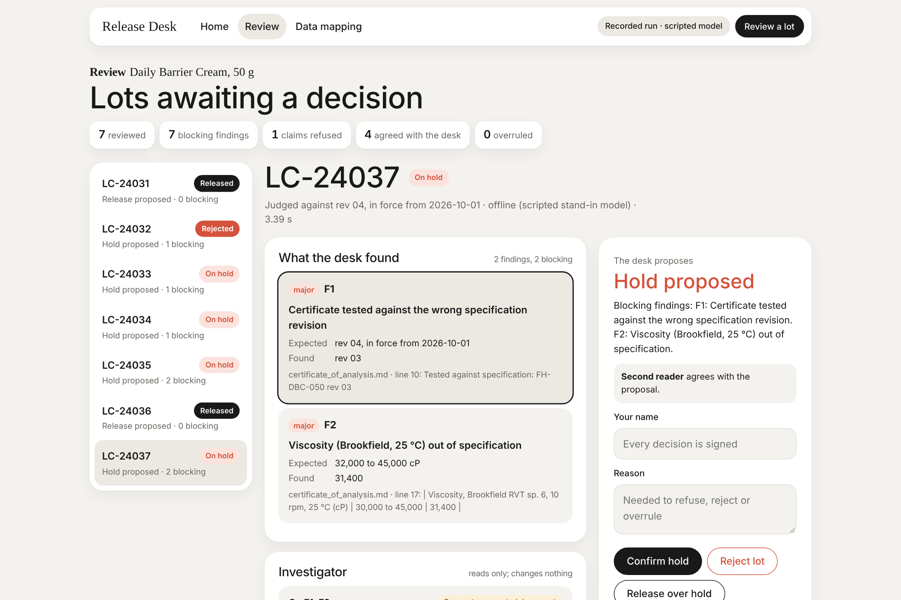

# Release Desk

**The model reads. Code checks. A person decides.**

Every lot that leaves a factory carries a promise it cannot speak for itself: that what is inside the tube is what the label says, made the way it was meant to be made. Somewhere a quality reviewer keeps that promise by reading. Certificates, batch records, deviation logs, line by line, lot after lot, until the reading becomes the job and the judgment gets the time that is left over.

Release Desk is a working prototype of a better division of labour. A model does the first read. Plain code checks what it found against the specification. A named person makes the release decision, with the evidence for every finding one click away. The machine is allowed to be fast. It is not allowed to be the one who says yes.

It is built on [Continuum](https://github.com/shyftlabs/continuum), an open-source agent framework by ShyftLabs, and uses its approval gate, structured output and in-process tools. All documents, people, products and companies in this repository are invented.

**[See a recorded run](https://moezusb.github.io/release-desk/)** (no install needed).



---

## What happens to a lot

```
documents ──► reader (model) ──► evidence check (code) ──► release rules (code) ──► proposer (model)
                                                                                         │
                         place_on_hold: runs at once ◄───────────────────────────────────┤
                                                                                         │
                         release_lot: second reader, then a named person ◄───────────────┘
                                      approve ─► the release tool checks the rules again ─► released
                                      refuse, silence or error ─► the lot stays on hold
```

1. **Read.** The reader turns three documents into structured fields. Every value must come with the line it was read from and a short quote of that line.
2. **Check the evidence.** Code looks at the cited line. If the value is not there, the claim is discarded and the field is treated as missing.
3. **Apply the rules.** Code compares every result with the specification, checks that the documents agree on lot number, product and dates, that every manufacturing step carries two different signatures, and that every deviation is closed. Each failure becomes a finding with a severity and its evidence.
4. **Propose.** The proposer calls one of two tools. `place_on_hold` runs at once. `release_lot` sits behind Continuum's approval gate.
5. **Second reading.** Before a person sees a release proposal, a second model checks that it follows from the findings and says so if it does not.
6. **Decide.** A reviewer approves or refuses the release, or confirms, rejects or releases over a hold. Every decision is signed, every override needs a reason, and all of it goes to an append-only log.

## Why it is built this way

**The model reads; it does not judge.** Whether 0.78 is less than 0.80 is not a matter of opinion, and nothing is gained by asking a language model for one. Rules live in `release_desk/rules.py`, where they can be read, tested and argued with.

**A claim without evidence is no claim.** Models are fluent, and fluency is not the same as accuracy. Every extracted value is checked against the line it cites. A value that is not on that line is thrown away, and the rules then treat the field as missing. One of the scripted lots contains a deliberate misquote so you can watch this happen.

**Every rule fails closed.** A missing result, an unreadable number, a blank signature: each is a finding, never a pass. Optimism is a fine quality in a person and a poor one in a release process.

**Saying no is cheap; saying yes needs a person.** Holding a lot costs a little time and can always be undone by someone who looks. Releasing one cannot be called back from a customer's bathroom shelf. So the hold tool runs freely and the release tool waits for a named reviewer.

**Silence is a no.** If nobody answers within the time limit, or the approval step fails, Continuum denies the call and the lot stays on hold. The desk never mistakes a quiet room for consent.

**Even a yes is checked.** The release tool runs only after approval, and it still refuses while any blocking finding is open. An approval is a judgment about a proposal, not a licence to skip the rules.

**A person may overrule the desk; the desk may never overrule a person.** A reviewer can release over a hold or refuse a proposed release, with a reason. Those overrides are counted, because a desk that is overruled often is telling you something about itself.

## Try it

Requires Python 3.13. No Docker, no database, no API key for the offline mode.

```bash
git clone https://github.com/Moezusb/release-desk.git
cd release-desk
python3.13 -m venv .venv && source .venv/bin/activate
pip install -e ".[dev]"

release-desk serve --offline        # open http://127.0.0.1:8930 and press "Review all"
```

**Offline mode** uses a scripted stand-in for the model: saved extractions written by hand to match the documents, and simple scripted proposals. It exists so anyone can see the whole flow in two minutes. Everything else (the evidence check, the rules, the approval gate, the release tool, the decision log) is the same code in both modes.

**Live mode** uses a real model through Continuum's Anthropic provider:

```bash
cp .env.example .env                # add ANTHROPIC_API_KEY
release-desk serve                  # live as soon as a key is present
```

Other commands:

```bash
release-desk review LC-24035        # one lot in the terminal ("all" for every lot)
release-desk eval                   # score every lot against data/golden.yaml
release-desk export-replay --offline # rebuild the static demo in docs/
pytest                              # 13 tests, offline, about 25 seconds
```

## The lots

Six lots of one fictional product, Daily Barrier Cream 50 g. Each was written to test one kind of judgment.

| Lot | What is wrong with it | What a careful reviewer does |
|---|---|---|
| LC-24031 | Nothing | Release |
| LC-24032 | Yeast and mould count of 40 CFU/g against a limit of 10 | Hold |
| LC-24033 | Every result passes, but a mixer temperature deviation is still open | Hold |
| LC-24034 | Filling step has no second signature. pH is exactly 6.0, on the limit, which passes | Hold |
| LC-24035 | Certificate carries a transposed lot number, and the preservative assay is low | Hold |
| LC-24036 | Yeast and mould result says "Pending", and the expiry uses 36 months instead of 30 | Hold |

The answers are in `data/golden.yaml`. The documents are generated by `scripts/make_lots.py`, so adding a lot is a few lines.

## Evaluation

`release-desk eval` runs every lot with nobody available to approve, so an evaluation can never release anything, and reports:

| Measure | Why it matters | Offline result |
|---|---|---|
| Unsafe release proposals | A release proposed where a hold was due. The only number that must be zero. | 0 |
| Known exceptions found | Recall on the problems planted in the lots | 7 of 7 |
| False alarms | Findings nobody expected; each one costs a reviewer's time | 0 |
| Proposals matching | Release or hold, as a careful reviewer would choose | 6 of 6 |

The offline result tests the plumbing and the rules, not a model's reading, because the readings are scripted. Run `release-desk eval` with a key to produce `eval/report-live.md` for the model you choose. That is the number worth reading, and on six lots it is a smoke test, not a validation.

## Where Continuum does the work

| Need | Continuum feature | File |
|---|---|---|
| Typed extraction the code can trust | `BaseAgent(output_schema=...)` with Pydantic models | `release_desk/agents.py`, `schemas.py` |
| Tools that run in-process | `MCPServerFunction`, `FunctionTool`, `ToolExecutor` | `release_desk/agents.py` |
| A person before the release tool runs | `AgentConfig(tool_approval={"*release_lot"}, approval_handler=..., approval_timeout=...)` | `release_desk/agents.py`, `pipeline.py` |
| Denial on timeout, crash or a malformed answer | Continuum's fail-closed approval gate | built in |
| Swapping the model without touching the agents | Provider registry (`register_provider`) | `release_desk/offline.py` |

## Known limits

- **No OCR.** The documents are text. Real batch records are scanned, handwritten and stamped, and reading them well is the hardest part of this problem. This prototype starts after that step.
- **Synthetic data, one product, six lots.** The rules cover one specification. A real deployment would load specifications per product and version them.
- **Names are typed, not authenticated.** A real system needs proper electronic signatures and access control, under whatever regulation applies to the product. Here, anyone can type any name.
- **Approvals wait in memory.** If the server restarts while a release is waiting, the approval is lost and the lot stays on hold. That is the safe direction to fail in, but it is still a failure.
- **The second reader advises; it does not block.** Its concerns are shown to the reviewer, who decides.

## Layout

```
data/spec/          the product specification (YAML)
data/lots/          one folder of documents per lot
data/golden.yaml    the answers a careful reviewer would give
release_desk/       reader, evidence check, rules, proposer, pipeline, store, CLI
web/                the reviewer's screen (FastAPI and one HTML file)
docs/               the static replay for GitHub Pages, and the product spec
eval/               evaluation reports
tests/              offline tests
```

The product decisions behind all this, including what counts as an exception and what the desk may do without asking, are in [docs/SPEC.md](docs/SPEC.md).

---

A release decision is small on any one day: a name, a date, a lot number. Over years it becomes the reputation of everything a company makes. The desk is here to give the person who signs more time to look, and better things to look at. The signature stays theirs.

Built by Mohamed Bah, with Claude as a collaborator on the code. MIT licensed. Continuum is Apache 2.0, by ShyftLabs.
