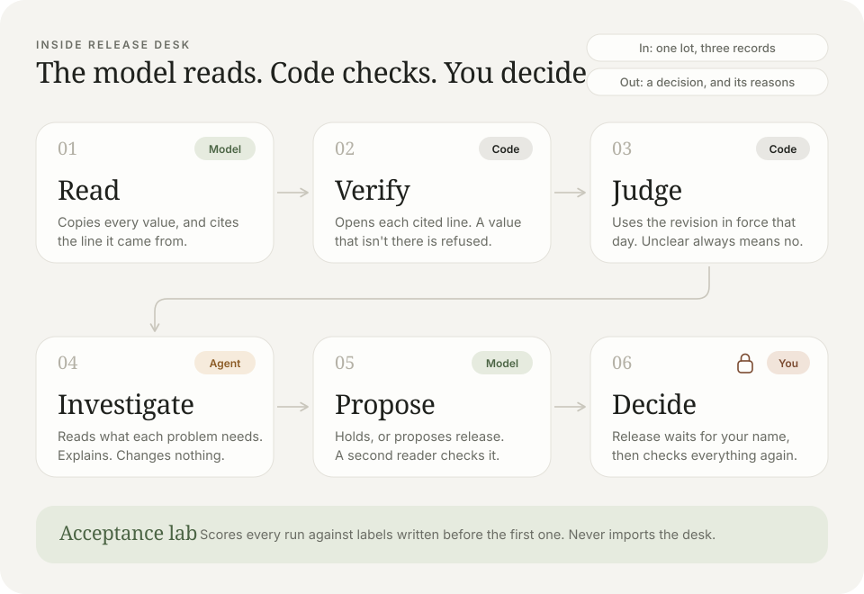

# Release Desk

**The model reads. Code checks. You decide.**

Before a lot of anything leaves a factory, someone signs for it. That signature rests on reading: a certificate of analysis, a batch record, a deviation log, line by line, lot after lot. Most lots are clean, and proving it takes most of the day. The lot that is not clean gets whatever attention is left.

Release Desk gives the reading to a machine and keeps the signature with a person. A model does the first read and must show where it found each value. Plain code checks every claim and applies the rules. An agent goes looking for the story behind each problem. Then everything stops, and waits for you.

Think of it as a very fast clerk who is not allowed to sign anything.

It runs on [Continuum](https://github.com/shyftlabs/continuum), an open-source agent framework by ShyftLabs. Every document, person, product and company here is invented.

**[Open the workspace](https://moezusb.github.io/release-desk/docs/)**. A recorded live run, with working decisions, corrections and the acceptance lab. Nothing to install, and nothing you decide leaves your browser.

<p align="center"></p>

---

## What it showed

Claude Sonnet 5.5, three runs of each of seven lots, every run from a clean state:

| | |
|---|---|
| Runs correct | **21 of 21** |
| Labelled exceptions found | **27 of 27**, all 9 critical ones included |
| Citations behind those findings that held up | **30 of 30** |
| Releases proposed for a lot that should be held | **0** |
| Clean lot proposed for release | **3 of 3** |
| Lots answered the same way in every repeat | **7 of 7** |
| Cost of one lot | about 27 seconds, 21,000 input and 4,100 output tokens |

The acceptance lab calls this **ready for business validation**, and stops there on purpose. Seven invented lots can prove the machinery works. Only real lots, and the people who know them, can prove it is worth using.

## Seven lots, seven kinds of judgment

| Lot | What is wrong | What a careful reviewer does |
|---|---|---|
| LC-24031 | Nothing | Release |
| LC-24032 | Yeast and mould count of 40 against a limit of 10 | Hold |
| LC-24033 | Every result passes, but a deviation is still open | Hold |
| LC-24034 | The filling step has no second signature. pH sits exactly on its limit, which passes | Hold |
| LC-24035 | A transposed lot number and a low preservative assay. The corrected certificate fixes only the first | Hold |
| LC-24036 | A pending result and a wrong expiry. The corrected certificate fixes both | Hold, then release after reassessment |
| LC-24037 | Tested against a retired revision. Viscosity passes the old one and fails the one in force | Hold |


## How it thinks

**The model reads. It does not judge.** Whether 0.78 is less than 0.80 is arithmetic, not opinion. Asking a language model is like asking a poet to balance your chequebook: the answer may be right, and you will still check it. So the rules live in plain code (`release_desk/rules.py`), where they can be read, tested and argued with.

**A citation is a receipt, and receipts get checked.** Every value the model reports must name its line. The evidence check opens that line and refuses any value that is not there, or that sits on a row about something else. A real number from the wrong row is the most convincing kind of mistake, which is why it gets a check of its own. Refused claims stay on the record for the reviewer to see.

**A train where the route is known, a taxi where it is not.** Reading, checking and proposing never change, so they run on rails. Investigating does: an open deviation needs its record, a wrong revision needs both revisions, a missing result needs to know whether a correction exists. That is where an agent choosing its own next read earns its keep, and the only place it is allowed to. It can read anything and change nothing.

**No is cheap. Yes needs a name.** A hold costs a little time and can be lifted by anyone who looks again. A release cannot be called back from a customer's bathroom shelf. So the hold tool runs freely, and the release tool waits behind an approval gate.

**Silence is a no.** If nobody answers in time, or the approval step fails, the release is refused and the lot stays on hold. The desk never mistakes a quiet room for consent.

**A signature covers the page it was put on.** Approval is bound to a fingerprint of what the reviewer saw: the documents, the findings, the proposal and the second reading. If any of it changes, the approval no longer counts. The release tool checks all of it once more before it acts, and refuses if anything has moved.

**Unclear means no.** Every rule fails closed. A value that is missing, unreadable or unverified fails the test it belongs to. When the desk is unsure, it holds, and tells you why.

**Corrections reopen the case.** When a corrected document arrives, earlier decisions are voided but never erased. The lot is reassessed on the new evidence, and the history shows what changed.

## The acceptance lab

A desk that grades its own homework learns only that it likes its own handwriting. `acceptance_lab/` is a separate package that never imports the desk. It reads three things: a bundle of results, labels written by hand before the first run (`acceptance_lab/labels.yaml`), and the source documents.

**Five gates, all required.** Every lot covered once per run. No release proposed for a lot that should be held. Every labelled exception found at the right severity, citing a line that proves it. The clean lot released, because a desk that holds everything would ace the rest. No unexpected findings, because a reviewer drowning in false alarms stops reading them. Every metric is shown as a fraction, so you can always see what it was divided by.

**Planted failures.** Two candidates are copies of real output with one flaw put in on purpose: a critical exception removed and its hold turned into a release, and a finding that quotes a real line from the wrong row. Both are refused. They prove the scorer bites. They are not model failures.

| Candidate | Runs passing | Verdict |
|---|---|---|
| Live workflow (Claude Sonnet 5.5, 3 runs per lot) | 21/21 | Ready for business validation |
| Offline workflow (scripted model, 5 runs per lot) | 35/35 | Further evidence required. A scripted model proves the checks, not a model |
| Missed critical exception (planted) | 6/7 | Not ready for a pilot |
| Real quote, wrong attribute (planted) | 6/7 | Not ready for a pilot |

**Mapping checks.** Before anyone builds on a client's systems, someone has to check that the data means what the mapping says it means. The checker compares a vendor's proposed mapping with three things the vendor did not write: the source systems' own dictionary, the fields the rules depend on, and the documents themselves, lot by lot. Each check ends as validated, failed, or needs business confirmation, for the questions only the client can answer.

| Scenario | Verdict |
|---|---|
| First delivery | Not acceptable. Yeast and mould mapped to the aerobic count, lots lost in the join, duplicate results, the test date used as the manufacture date, month-first dates in day-first data, a preservative 100 times too small, every lot judged by the latest revision |
| Revised delivery | Acceptable once one question is answered: does "Closed - effectiveness check pending" count as closed for release? |
| Same unit, wrong meaning | Caught. Both fields are CFU/g, and they count different organisms |
| Fraction treated as percent | Caught. The conversion is missing |
| Ambiguous date convention | Caught. The declared convention does not fit the data |
| Equal row count hides a lost lot | Caught. Seven packets for seven batches, but one batch twice and one not at all |

The last one is worth remembering. Matching totals are the oldest disguise in data: the count is right because two mistakes cancel out.

**Business UAT and value.** Labels test the output. They do not test whether a person can use it. Six tasks (find the evidence, notice what is missing, spot the wrong revision, know what an approval authorises, resume after a correction, name the next owner) are written down and marked not yet run, because no real quality team has run them. The value worksheet is a calculator with its formula in plain view. The only measured numbers in it are machine time and tokens, taken from the live run.

## What the first live run taught

The first live run found every exception and failed every lot.

The model had copied a yield as "98.4%", exactly as the batch record wrote it. The parser expected "98.4", could not read the rest, and failed closed, as it was built to. The model was right and the code was too proud to agree. A lock that refuses the right key is still a broken lock, even if it fails in the direction you would choose.

The fix took one line. Finding its siblings took longer. A strict simulated API now replays the live path without cost and answers five ways a real model might: through the schema tool, as text in a code fence, after a thinking block, with units copied verbatim, and with labels copied whole ("Lot number: LC-24033"). On the old rules, that last style produced 34 false findings and hid two real ones. The same search turned up two gaps that pointed the dangerous way: "Not absent" passed the pathogens test, and "N/A" counted as a signature. Both are closed, and both now have tests.

The second live run is the one in the table above.

## Evaluation

Correctness first, consistency second. Five runs that agree on a wrong answer are worse than one run that is right. Every run is scored on its own against answers written before any run (`data/golden.yaml`), from a clean state.

| Measure | Why it matters |
|---|---|
| False clears | A release proposed where a hold was due. The one number that must be zero |
| Blocking findings found | Did it catch what was planted, in every run? |
| Clean lots proposed for release | A desk that holds everything would ace the first two |
| Lots correct in every run | An average hides the lot that fails one time in three |
| Agreement between runs | Useful only once the runs are right |
| Time and tokens per lot | So the cost is a number, not a guess |

Results go to `eval/report-*.md` and `eval/results-*.json`. Offline runs use a scripted model, so they test the checks and controls, not a model's reading.

## Run it yourself

Python 3.13. No Docker, no database. Without credentials it runs offline with a scripted model, for free.

```bash
git clone https://github.com/Moezusb/release-desk.git && cd release-desk
python3.13 -m venv .venv && source .venv/bin/activate
pip install -e ".[dev]"

release-desk serve --offline         # the workspace at http://127.0.0.1:8930
release-desk review LC-24037         # one lot, in the terminal
release-desk eval --repeat 3         # the evaluation
python -m acceptance_lab evaluate eval/results-offline.json
python -m acceptance_lab check-mapping
pytest                               # 35 tests, all offline
```

**Live runs** use a real model, and real money. Locally, put `ANTHROPIC_API_KEY` in `.env`. On GitHub, the **Live evaluation** workflow (Actions, then Run workflow) takes either an `ANTHROPIC_API_KEY` secret or workload identity federation, which trades GitHub's short-lived identity for a short-lived Anthropic token, so no key is stored anywhere. It reviews one lot first as a smoke test, so a broken setup fails for cents. Then it runs the evaluation, re-records the public page from the live run, rebuilds the acceptance results and commits them. Three runs per lot reviews 21 lots, plus about ten more to record the page. Run it when the engine changes, not for luck.

## Where Continuum does the work

| Need | Continuum feature | File |
|---|---|---|
| Typed extraction the code can trust | `BaseAgent(output_schema=...)` | `release_desk/agents.py` |
| A model that chooses its own next read | An agent loop over in-process tools (`MCPServerFunction`, `ToolExecutor`) | `release_desk/investigate.py` |
| A person before the release tool runs | `AgentConfig(tool_approval=..., approval_handler=..., approval_timeout=...)`, failing closed | `release_desk/agents.py`, `pipeline.py` |
| One switch between live and scripted models | The provider registry (`register_provider`) | `release_desk/offline.py` |
| Structured answers from current Claude models | Continuum forces a tool choice that current models refuse. A small provider offers the same tool unforced and unwraps the answer. The framework version is pinned for it | `release_desk/anthropic_compat.py` |

## Known limits

- **No OCR.** The documents are text. Real batch records are scanned, handwritten and stamped, and reading them well is the hardest part of the problem. This prototype starts after that step.
- **No business validation.** The labels, gates and UAT tasks are a reasoned starting point. Real thresholds, criticality and exit criteria belong to the people who own the process.
- **Small, synthetic, one product.** Seven lots and one specification with two revisions make a good test of the machinery and a poor test of the world. A pilot would use a frozen set drawn from real history.
- **Tested variations, not every variation.** The simulated API covers the formats a model is likely to use. A real model can still surprise it, and the rules fail toward a hold when it does.
- **Names are typed, not authenticated.** A real system needs proper electronic signatures and access control under whatever regulation applies.
- **Approvals wait in memory.** A restart while a release is waiting loses the approval and leaves the lot on hold. The safe way to fail, but still a failure.

## Layout

```
data/spec/          specification revisions, with the dates they were in force
data/lots/          the documents for each lot, with corrections/ and records/ where they exist
data/mapping/       source extracts, their dictionary, the canonical fields, vendor mappings
data/golden.yaml    the answers a careful reviewer would give
release_desk/       reader, evidence check, rules, investigator, proposer, evaluation
acceptance_lab/     labels, scorer, planted failures, mapping checks, UAT tasks
web/                the workspace (FastAPI and one HTML file)
docs/               the public page, its recorded data, the diagram and the product spec
eval/               evaluation reports and result bundles
scripts/            the generators for the synthetic lots and source extracts
tests/              35 tests, including the live path against a simulated API
```

The product decisions behind all of this are in [docs/SPEC.md](docs/SPEC.md).

---

A release decision is small on any given day: a name, a date, a lot number. Over the years it becomes the reputation of everything a company makes. The desk exists to give the person who signs more time to look, and better things to look at. The pen stays in their hand.

Built by Mohamed Bah. Claude collaborated on the code. An earlier prototype made with ChatGPT shaped the interface and the idea of a separate acceptance lab. MIT licensed. Continuum is Apache 2.0, by ShyftLabs.
